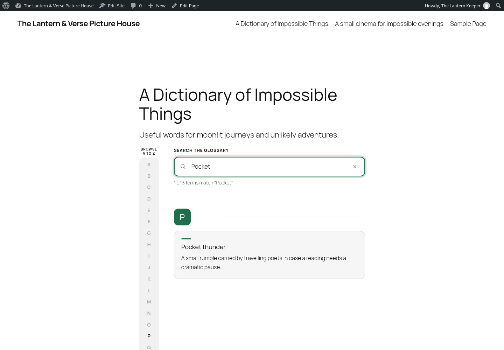
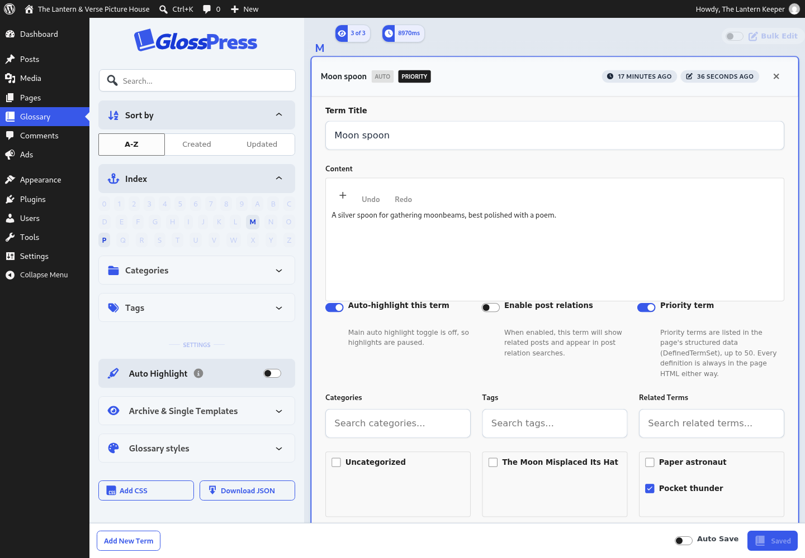

<!-- ACE_SUITE_BRAND:START -->
<p align="center">
  <a href="https://acemedia.ninja/"></a>
</p>

<p align="center">
  <a href="https://acemedia.ninja/">Ace Media</a> · <a href="https://acemedia.host/">WordPress hosting</a>
</p>
<!-- ACE_SUITE_BRAND:END -->

# GlossPress - WordPress Glossary Plugin

Release candidate 1.2.2. Requires WordPress 6.6 and PHP 7.4 or later. See [release validation](docs/release-validation.md) and [developer contracts](docs/wiki/Developer-guide.md).

Part of my [Ace Media suite](https://acemedia.ninja/), with hosting at [Ace Media hosting](https://acemedia.host/). Public issues are welcome; please discuss contributions before opening a pull request. Official development remains maintained by Ace Media, without limiting GPL rights.

A comprehensive glossary system for WordPress with intelligent auto-highlighting, related posts, and a React-based admin interface.

**Version:** 1.2.2  
**Author:** AceMedia

---

## Table of Contents

- [Overview](#overview)
- [Features](#features)
- [Installation](#installation)
- [User Guide](#user-guide)
  - [Creating Glossary Terms](#creating-glossary-terms)
  - [Managing Categories & Tags](#managing-categories--tags)
  - [Auto-Highlighting](#auto-highlighting)
  - [Related Posts](#related-posts)
  - [Displaying Your Glossary](#displaying-your-glossary)
- [How Term Associations Work](#how-term-associations-work)
- [Shortcode & Block Usage](#shortcode--block-usage)
- [Settings & Customization](#settings--customization)
- [Developer Reference](#developer-reference)

---

## Overview

GlossPress allows you to create and manage a glossary of terms that can be:
- **Automatically highlighted** in your post content with tooltips
- **Associated with posts** through categories and tags
- **Displayed** in customizable glossary pages using shortcodes or Gutenberg blocks
- **Related to other terms** for easy cross-referencing

---

## Features

### ✨ Core Features
- **Smart Auto-Highlighting** - Automatically highlight glossary terms in post content with hover tooltips
- **Related Posts** - Show posts that use specific glossary terms
- **Category & Tag Filtering** - Control which posts see which terms
- **React-Based Admin** - Fast, modern interface for managing terms
- **Gutenberg Block** - Display glossary using the block editor
- **Shortcode Support** - Use `[glossary]` shortcode anywhere
- **Related Terms** - Link related glossary terms together
- **Responsive Design** - Works on all devices
- **Crawlable** - Every definition is rendered on the server, so crawlers see the full glossary with or without JavaScript
- **SEO-Friendly** - One Schema.org `DefinedTermSet` per glossary page, listing your priority terms

### 🎨 Customization
- Custom colors for headings, backgrounds, and text
- Adjustable spacing and padding
- Multiple sort options (alphabetical, newest, oldest)
- Card grid with a sticky A to Z rail on wide screens and a pinned letter strip on phones

---

## Installation

1. Upload the `GlossPress` folder to `/wp-content/plugins/`
2. Activate the plugin through the 'Plugins' menu in WordPress
3. Navigate to **Glossary** in your WordPress admin menu

---

## User Guide

### Creating Glossary Terms

1. Go to **Glossary** in your WordPress admin menu
2. Click **Add New Term**
3. Fill in the term details:
   - **Title** - The glossary term (e.g., "SEO", "WordPress", "API")
   - **Content** - The definition or explanation of the term
   - **Related Terms** - Link to other glossary terms
   - **Categories & Tags** - Assign categories/tags to control where the term appears

4. Configure term settings:
   - **Auto-highlight this term** - Enable to highlight this term in post content
   - **Enable Post Relations** - Enable to show related posts for this term

5. Click **Save** or **Save & Close**

### Managing Categories & Tags

Categories and tags determine **which posts** your glossary terms will appear on.

#### Assigning Categories/Tags to Terms
1. Edit a glossary term
2. Select categories/tags from the dropdown menus in the right sidebar
3. Save the term

#### How It Works
- If a term has categories/tags: It only appears on posts that share at least one category OR tag
- If a term has NO categories/tags: It appears on **all posts** (universal term)

**Example:**
- A term tagged with "Sports" → Only appears on posts tagged "Sports"
- A term with no tags/categories → Appears on all posts

### Auto-Highlighting

Auto-highlighting automatically wraps glossary terms in post content with styled `<span>` elements that show tooltips on hover.

#### Enabling Auto-Highlighting

**Global Toggle:**
1. Go to **Glossary** admin page
2. Toggle **Auto Highlight** in the top-right corner
3. This master switch controls all auto-highlighting

**Per-Term Toggle:**
1. Edit a glossary term
2. Enable **Auto-highlight this term**
3. Save the term

**Requirements:**
- ✅ Global "Auto Highlight" must be ON
- ✅ Per-term "Auto-highlight this term" must be ON
- ✅ Term must share a category/tag with the post (or have none)

#### How It Works
- Only the **first occurrence** of each term is highlighted per post
- **Longest terms prioritized** - If you have "SEO" and "SEO Optimization" as separate terms, the longer one takes precedence
- **Word boundaries respected** - "ace" won't match "place" or "aced", and accented letters count as letters, so "Café" matches but "Cafés" does not
- **Case-insensitive** matching, and a straight or curly apostrophe in a term matches either
- **Nested terms** - a shorter term never lands inside a longer one, even after the longer one has been used, and is highlighted where it stands alone instead
- **Skipped text** - headings, links, buttons, labels, `<summary>`, form fields, code, quotes (`<blockquote>`), captions (`<figcaption>`) and SVG are left alone. Add the class `no-glossary` to any element to keep terms out of it, or change the list with the `acemedia_glossary_skip_elements` filter
- A term is not highlighted on its own glossary page

### Related Posts

The Related Posts feature shows posts that contain specific glossary terms.

#### Enabling Related Posts
1. Edit a glossary term
2. Enable **Enable Post Relations**
3. Save the term

#### How It Works
- When viewing a glossary term (on the glossary page), related posts are displayed below
- Posts are matched by:
  1. **Exact term match** in title or content (highest priority)
  2. **Shared categories/tags** (fallback)
- Same category/tag filtering rules apply
- Related posts load when a reader presses **Show related articles** on the term

### Priority Terms

Tick **Priority term** on a term to include it in the glossary page's structured data
(`DefinedTermSet` / `DefinedTerm` JSON-LD). Keep it to the terms that matter most: the
list is capped at 50 (filter `acemedia_glossary_schema_term_limit` to change it).
Priority only affects the structured data; every definition is always in the page HTML.
The flag is stored in the `priority` post meta and exposed over REST.

### Displaying Your Glossary

You can display your glossary in three ways:

#### 1. Shortcode (Classic Editor or anywhere)
```
[glossary]
```

Optional attributes:
```
[glossary sort="alphabetical"]
[glossary sort="newest"]
[glossary sort="oldest"]
```

#### 2. Gutenberg Block
1. Add a block
2. Search for "Glossary"
3. Insert the Glossary block
4. Customize settings in the block sidebar

#### 3. Custom Template
The plugin includes archive and single templates that can be overridden by your theme.

---

## How Term Associations Work

Understanding how glossary terms associate with posts is key to using GlossPress effectively.

### Association Logic

A glossary term will appear on a post if **ANY** of these conditions are true:

1. **Shared Category** - The term and post share at least one category
2. **Shared Tag** - The term and post share at least one tag
3. **No Assignment** - The term has NO categories AND NO tags (universal term)

### Examples

**Example 1: Targeted Term**
- Glossary Term: "Penalty Kick"
- Categories: Football
- Result: Only appears on posts in the "Football" category

**Example 2: Multi-Category Term**
- Glossary Term: "Champion"
- Categories: Football, Rugby, Boxing
- Result: Appears on posts in Football, Rugby, OR Boxing categories

**Example 3: Universal Term**
- Glossary Term: "Sports Betting"
- Categories: None
- Tags: None
- Result: Appears on **all posts**

### Best Practices

- **Specific terms** → Assign relevant categories/tags
- **General terms** → Leave categories/tags empty
- **Cross-category terms** → Assign multiple categories
- **Seasonal terms** → Use tags for temporary associations

---

## Shortcode & Block Usage

### Shortcode Attributes

```
[glossary 
  sort="alphabetical"
  textColor="#333333"
  headingBackgroundColor="#f5f5f5"
  headingTextColor="#000000"
  cardBackgroundColor="#ffffff"
  contentGap="1.5rem"
  headingPadding="1.25rem"
]
```

**Attributes:**
- `sort` - "alphabetical", "newest", or "oldest"
- `textColor` - Hex color for body text
- `headingBackgroundColor` - Hex color for card headers
- `headingTextColor` - Hex color for header text
- `cardBackgroundColor` - Hex color for card backgrounds
- `contentGap` - CSS unit for spacing between cards
- `headingPadding` - CSS unit for header padding

### Gutenberg Block

The Glossary block supports all the same customization options through the block sidebar panel.

---

## Settings & Customization

### Global Settings

Access global settings from the **Glossary** admin page (top-right toggles):

- **Auto Highlight** - Master toggle for all auto-highlighting
- **Enable Templates** - Allow custom single/archive templates
- **Template Settings** - Toggle template functionality on/off

### Style Settings

Customize the appearance using:
- WordPress Customizer integration (coming soon)
- Block editor sidebar (when using Gutenberg block)
- Shortcode attributes (for manual control)

### Performance Settings

The plugin includes automatic optimizations:
- **Lazy Loading** - Term details load on-demand
- **Caching** - Transient caching for glossary terms (1 hour)
- **Single Active Term** - Only one term expanded at a time in admin

---

## Developer Reference

### File Structure

```
GlossPress/
├── acemedia-glossary.php          # Main plugin file
├── admin/
│   ├── class-admin.php            # Admin interface
│   └── class-api.php              # REST API endpoints
├── includes/
│   ├── class-post-type.php        # Custom post type registration
│   ├── class-shortcode.php        # Shortcode & auto-highlighting
│   ├── class-related-posts.php    # Related posts logic
│   ├── class-template-loader.php  # Template handling
│   └── migration-auto-highlight.php # Migration script
├── src/                           # React source files
├── build/                         # Compiled assets
└── templates/                     # PHP templates
```

### REST API Endpoints

**GET** `/wp-json/wp/v2/glossary`
- Returns summary data for all terms

**GET** `/wp-json/wp/v2/glossary/{id}`
- Returns full data for a specific term

**POST** `/wp-json/wp/v2/glossary`
- Creates or updates a glossary term

**POST** `/wp-json/wp/v2/glossary/{id}/related`
- Updates related terms (bidirectional)

**POST** `/wp-json/wp/v2/glossary/{id}/categories`
- Updates term categories

**POST** `/wp-json/wp/v2/glossary/{id}/tags`
- Updates term tags

### Hooks & Filters

**Filters:**
```php
// Modify related post types
add_filter('acemedia_glossary_related_post_types', function($post_types) {
    return array('post', 'custom_type');
});

// Modify content before auto-highlighting
add_filter('the_content', 'your_function', 9); // Run before highlight_glossary_terms (priority 10)

// Limit auto-highlighting to certain post types (option or filter; empty = all singular views)
update_option('acemedia_glossary_highlight_post_types', array('post'));
add_filter('acemedia_glossary_highlight_post_types', function($post_types) {
    return array('post', 'article');
});

// Veto highlighting for a specific post
add_filter('acemedia_glossary_should_highlight', function($should, $post) {
    return $should && !has_term('no-glossary', 'post_tag', $post);
}, 10, 2);

// Serve the lightweight tooltip instead of React + wp-components
update_option('acemedia_glossary_tooltip_mode', 'light');

// Highlight inside quotes again (element names, lower case)
add_filter('acemedia_glossary_skip_elements', function($elements) {
    return array_diff($elements, array('blockquote'));
});
```

The highlighter is skipped automatically for REST API responses, `/wp-json/` requests, feeds, embeds, AJAX, cron and excerpt generation.

### Custom Post Meta

Each glossary term has the following meta fields:
- `auto_highlight` (bool) - Enable auto-highlighting
- `enable_post_relations` (bool) - Enable related posts
- `related_terms` (array) - IDs of related glossary terms
- `synonyms` (array) - Alternative spellings that also trigger the highlight (e.g. `["Hendo's"]`)

### Code Locations

**Auto-Highlighting Logic:**
- File: `/includes/class-shortcode.php`
- Function: `highlight_glossary_terms()`
- Lines: 285-472

**Related Posts Logic:**
- File: `/includes/class-related-posts.php`
- Function: `AceMediaGlossary_Related_Posts::fetch()`
- Lines: 7-411

**Category/Tag Filtering:**
- Auto-highlight: Lines 312-330 in `class-shortcode.php`
- Related posts: Lines 343-376 in `class-related-posts.php`

### Development Setup

1. Install dependencies:
```bash
npm install
```

2. Build assets:
```bash
npm run build
```

3. Development mode (watch):
```bash
npm run dev
```

### Performance Notes

- Glossary terms are cached using WordPress transients (1 hour TTL)
- Cache keys include category/tag hashes for accurate filtering
- Lazy loading in admin reduces initial payload
- Only one term can be active/editing at a time to reduce memory usage

### Database Schema

Glossary terms use the standard WordPress post structure:
- Post Type: `acemedia_glossary`
- Taxonomies: WordPress built-in categories and tags (control where terms highlight) plus the private `glossary_group` taxonomy (organisation only)
- Meta: Stored in `wp_postmeta` table

---

## Support

For issues, feature requests, or questions:
- Contact: Shane Rounce (https://github.com/AceMedia)
- Repository: https://github.com/AceMedia/GlossPress

## License

GPL-2.0-or-later. See [LICENSE](LICENSE).

---

## Changelog

### Version 1.2.1
- The tooltip stylesheet is printed inline instead of as a render-blocking `<link>`, and the tooltip script loads with `defer`, so highlights cost nothing on first paint. The `acemedia-glossary-tooltips` handle keeps its name. The glossary page's stylesheet can now be inlined by WordPress too.
- Tooltip assets now load on classic themes as well (they were added to `wp_enqueue_scripts` after it had already run).
- Light tooltips open on the first tap on touch screens (the emulated hover and the tap's click used to cancel each other out), a click on a hovered term pins it open instead of closing it, they follow the term on resize, and once hidden they leave the accessibility tree. Clicking a term no longer cancels a surrounding `<summary>` or `<label>`.
- Light tooltips can be hovered: the mouse can move from the term onto the tooltip without it closing (WCAG 1.4.13), and moving the mouse off one term no longer closes a tooltip that another term opened by keyboard focus. A second tap closes a tooltip in browsers without Pointer Events too.
- Glossary titles, synonyms and definitions with stray non-UTF-8 bytes are scrubbed instead of dropping the term with a PHP deprecation notice.
- Matching finds every occurrence in a text node, so a term that first appears inside a longer one is still highlighted where it stands alone. Accented words, curly apostrophes and entity-encoded titles match properly.
- New skipped elements (`label`, `summary`, form fields, `blockquote`, `figcaption`, `svg` and more), the `no-glossary` class and the `acemedia_glossary_skip_elements` filter.
- Removed the REST nonce meta tag and inline script printed into every page head for logged-in users. Nothing read it, and WordPress already sets up its own nonce for `wp.apiFetch`.

### Version 1.2.0
- Auto-highlighting can be scoped to specific post types with the `acemedia_glossary_highlight_post_types` option (array of post type names; empty keeps the old "every singular view" behaviour) and the filter of the same name. A second filter, `acemedia_glossary_should_highlight`, gives the final say per post.
- The highlighter never runs for REST API responses, `/wp-json/` requests, feeds, embeds, AJAX, cron or excerpt generation, so structured data and API clients always receive untouched content.
- Terms accept alternative spellings through a `synonyms` post meta array (exposed in the REST API and in export/import). Matching any synonym highlights the term with the same tooltip.
- New private `glossary_group` taxonomy for organising terms inside the glossary. Unlike categories and tags it does not restrict which posts a term appears on.
- Settings export/import carries `highlightPostTypes`.
- New `acemedia_glossary_tooltip_mode` option (and filter): `components` keeps the React and wp-components tooltip; `light` serves a 2 KB vanilla CSS/JS tooltip instead, saving roughly 1 MB of scripts and styles on every highlighted page. Style it with the `--glossary-tooltip-bg`, `--glossary-tooltip-color`, `--glossary-tooltip-term-color` and `--glossary-highlight-underline` custom properties.
- Highlight spans carry a `data-term` attribute with the canonical term title (useful when a synonym matched), and text inside links, buttons, code and pre blocks is left alone.
- Tooltip definitions are no longer double-encoded (apostrophes and ampersands showed as entities).

### Version 1.1.0
- Consolidated feature set across forks
- Every distinct term in a paragraph is highlighted; themes with no colour presets are handled
- Built assets are versioned by modification time so rebuilds bust CDN caches

### Version 1.0.0
- Initial release
- React-based admin interface
- Auto-highlighting with tooltips
- Related posts functionality
- Category/tag filtering
- Gutenberg block support
- Performance optimizations

## Fictional demonstration

The Lantern & Verse Picture House uses a dictionary of impossible things to show the glossary in use. All example content is fictional.





Developer contracts are in [the wiki source](docs/wiki/Developer-guide.md). Public issues are welcome; please discuss a contribution before opening a pull request. Ace Media maintains official releases, with the GPL licence unchanged.
